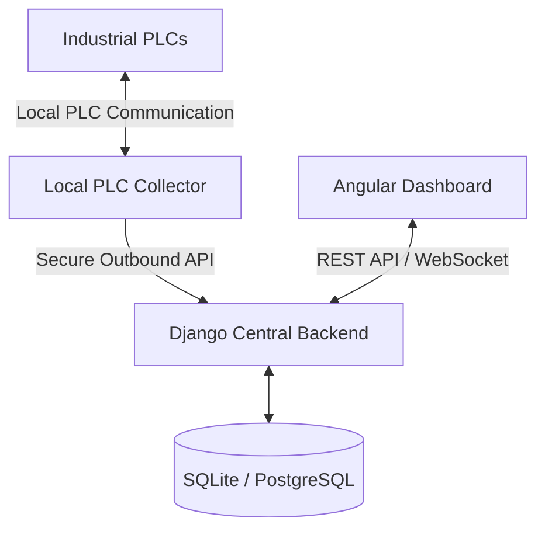

# Live PLC Dashboard – Industrial IoT Platform

A modern Industrial Internet of Things (IIoT) platform for real-time PLC monitoring, production tracking, machine health monitoring, and industrial data analytics.

The platform is designed to connect factory-floor PLCs with a centralized backend and a real-time web dashboard. It supports multiple companies, plants, production lines, stations, PLC devices, and configurable PLC tags.

## Project Overview

Live PLC Dashboard aims to provide a centralized solution for monitoring industrial production processes.

The platform consists of three independent components:

1. **Angular Frontend** – Industrial monitoring dashboard and configuration interface.
2. **Django Backend** – Central API, authentication, database management, telemetry processing, and real-time communication.
3. **Local PLC Collector** – Connects to PLCs inside the factory network and securely transmits collected data to the backend.

A key architectural principle is that the central backend does not need direct access to factory PLC IP addresses. The local collector initiates communication with the backend.

## Technology Stack

### Frontend
- Angular
- TypeScript
- Angular Router
- RxJS
- Reactive Forms
- Angular Material
- ECharts / Chart.js
- WebSockets

### Backend
- Python
- Django
- Django REST Framework
- Django Channels
- ASGI / Daphne
- REST APIs
- WebSockets

### Databases
- SQLite – Local development and small installations.
- PostgreSQL – Production deployments and larger installations.

### PLC Communication
- Siemens S7
- Modbus TCP
- Mock PLC Simulator

## System Architecture



## Plant and Station Hierarchy

The application follows a configurable industrial hierarchy:

```text
Company
  └── Plant
       └── Production Line
            └── Station
                 └── PLC Device
                      └── PLC Tags
```

The system is designed to support multiple companies, plants, production lines, stations, PLCs, and tags without hardcoding station-specific configurations.

## Key Functional Areas

### 1. Plant Management
- Company management.
- Plant management.
- Production line management.
- Station management.
- PLC device configuration.

### 2. PLC Tag Configuration
- Configurable PLC addresses.
- Data types and engineering units.
- Tag polling intervals.
- Scaling and offsets.
- Production trigger configuration.
- Result status mapping.

### 3. Live Monitoring
- PLC connection status.
- Collector connection status.
- Machine running and idle status.
- Live PLC tag values.
- Production counters.
- PASS/FAIL monitoring.
- Active alarms.
- Real-time production events.

### 4. Production Tracking
- Station-wise production records.
- Production event detection.
- PASS/FAIL classification.
- Historical production records.
- Production trends.
- Hourly and daily production reports.
- Shift-wise analytics.

### 5. Excel-Like Production Data

Production records will be available through a station-specific tabular reporting interface.

Example:

| Timestamp | PLC Name | Result Status | Output | Torque | Pressure |
|---|---|---|---|---|---|
| 2026-01-01 10:00:00 | Middle Testing PLC | PASS | 1 | 10.5 | 4.2 |
| 2026-01-01 10:00:05 | Middle Testing PLC | FAIL | 1 | 9.2 | 3.8 |

Columns will be generated from the configured station tags.

The intended database architecture uses normalized production records as the canonical source of truth, with station-specific reporting tables or views where appropriate.

### 6. Local PLC Collector
- Modular PLC communication adapters.
- Siemens S7 support.
- Modbus TCP support.
- Mock PLC simulation.
- Configurable tag polling.
- Production event detection.
- Persistent offline event queue.
- Automatic reconnection.
- Retry mechanisms.
- Collector heartbeat and health monitoring.

### 7. Security
- User authentication.
- Role-based authorization.
- Secure collector authentication.
- Hashed collector credentials.
- Environment-based configuration.
- HTTPS support for production.
- Audit logging.
- Protected PLC configuration.

## Database Architecture

The planned database entities include:

- Company
- Plant
- ProductionLine
- Station
- PLCDevice
- PLCTag
- CollectorAgent
- CollectorHeartbeat
- TagReading
- ProductionEvent
- User
- Role
- AuditLog
- AlarmEvent

Both SQLite and PostgreSQL are supported design targets through Django's ORM.

## Project Structure

The intended high-level organization is:

```text
Live-PLC-Dashboard/
│
├── backend/
│   ├── config/
│   ├── apps/
│   ├── api/
│   ├── requirements.txt
│   └── manage.py
│
├── frontend/
│   ├── src/
│   ├── angular.json
│   └── package.json
│
├── collector/
│   ├── adapters/
│   ├── communication/
│   ├── core/
│   ├── events/
│   ├── services/
│   ├── storage/
│   └── main.py
│
├── documentation/
│   ├── ARCHITECTURE.md
│   ├── DATABASE_DESIGN.md
│   ├── PLC_CONFIGURATION.md
│   ├── COLLECTOR_SETUP.md
│   ├── API_REFERENCE.md
│   ├── REALTIME_COMMUNICATION.md
│   ├── DEPLOYMENT.md
│   ├── WINDOWS_SETUP.md
│   └── TROUBLESHOOTING.md
│
├── docker-compose.yml
├── .env.example
├── .gitignore
└── README.md
```

## Development and Deployment Goals

The platform is intended to support:

- Local Windows development.
- SQLite-based development environments.
- PostgreSQL production deployments.
- Docker-based deployment.
- Independent collector execution on factory computers.
- Secure communication between collectors and the central backend.
- Mock PLC-based development without physical hardware.

## Testing Strategy

The project will include:

- Backend unit and integration tests.
- REST API tests.
- Database compatibility tests.
- Collector adapter tests.
- Mock PLC simulation tests.
- Production event detection tests.
- Duplicate event prevention tests.
- Offline queue and retry tests.
- WebSocket tests.
- Angular component and service tests.
- Frontend production build verification.

## Project Status

This repository is the starting point for a new IIoT platform implementation.

Features, hardware integrations, database compatibility, and end-to-end workflows must be verified through actual implementation and testing before being considered production-ready.

Physical PLC integrations will require validation against the relevant hardware and network configuration.

## Engineering Principles

- Clean architecture and separation of concerns.
- Configurable plant and station hierarchy.
- Reliable production data persistence.
- Idempotent production event ingestion.
- Secure collector-to-backend communication.
- SQLite and PostgreSQL compatibility.
- Typed and maintainable code.
- Explicit error handling and structured logging.
- Comprehensive testing and documentation.

## Repository

**GitHub:** https://github.com/avviiiral/Live-PLC-Dashboard

**Development branch:** `feature/live-plc-dashboard-platform`

---

*Building a reliable, scalable, and configurable Industrial IoT platform for real-time manufacturing intelligence.*